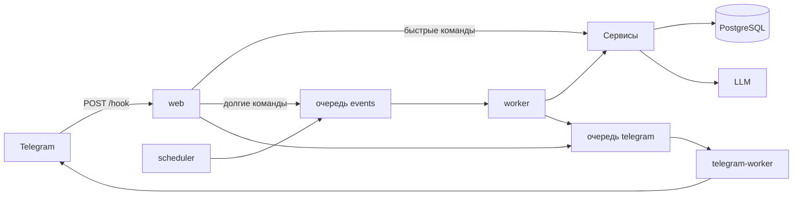

# Архитектура

Приложение — слоистый монолит. Канал общения (Telegram или CLI) не содержит
бизнес-логики: он принимает запрос, вызывает сервисы и отправляет ответ.

## Процессы



| Сервис | Роль |
| --- | --- |
| `web` | FastAPI, webhook `POST /hook`, регистрация меню бота |
| `scheduler` | раз в секунду забирает пользователей с просроченным `next_run_at` и публикует событие занятия |
| `worker` | очередь `events`: занятие, ответ, слова, расписание, таймзона, свободный текст |
| `telegram-worker` | очередь `telegram`: отправка сообщений в чат |
| `db` | PostgreSQL |
| `rabbitmq` | брокер Taskiq |
| `ollama` | локальная модель в dev-окружении |

Клиент Telegram — aiogram. Исходящие сообщения пишет отдельный пул, чтобы
медленный Bot API не блокировал разбор апдейтов и учебные задачи.

## Слои

```
presentation    FastAPI webhook, CLI (`make chat`)
application     сервисы сценариев и `Container`
domain          модели, статусы, правила прогресса, графы LangGraph
infrastructure  PostgreSQL, RabbitMQ/Taskiq, Telegram API, LLM-провайдеры
```

`Container` собирает зависимости. Репозиторий получает фабрику сессии,
сервис — репозитории и `Container.transaction`. Внешняя транзакция открывает
сессию, вложенные вызовы переиспользуют её через `ContextVar`.

Presentation не знает ORM и провайдера модели. Сервисы не знают aiogram:
они возвращают текст и клавиатуру, а адаптер публикует это в очередь
`telegram`.

## Поток запроса

1. Telegram присылает апдейт на `/hook`. Заголовок
   `X-Telegram-Bot-Api-Secret-Token` сверяется с секретом, который процесс
   генерирует при старте и передаёт в `setWebhook`. Чужой запрос получает 401.
2. Сервис сохраняет `update_id` и пользователя. Повтор апдейта отбрасывается.
3. Команда или callback разбираются по `intent` пользователя.
4. Короткие команды (`/start`, `/schedule`, `/cancel`, `/finish` и другие)
   выполняются в запросе webhook.
5. Шаги с LLM (`/study`, ответ, `/add_words`, таймзона, разбор времени,
   свободный текст при `unknown`) уходят в очередь `events` вместе с
   `user_id` и `version`.
6. Воркер блокирует пользователя по версии, вызывает сервис и публикует ответ
   в очередь `telegram`. Устаревшая версия молча подтверждается: параллельный
   апдейт уже обработан.

Планировщик не вызывает учебные сервисы сам. Он сдвигает `next_run_at` на
короткий lease и публикует то же событие `schedule`, что обрабатывает `worker`.

## Данные

| Сущность | Смысл |
| --- | --- |
| `users` | Telegram ID, `intent`, `version`, таймзона, `next_run_at` |
| `words` | общий каталог английского текста и эталонных переводов |
| `vocabulary_items` | слово пользователя и баллы повторения |
| `study_sessions` | занятие и его статус |
| `study_attempts` | вопрос, ответ, вердикт |
| `study_schedule_slots` | ежедневное время занятия в локальной таймзоне |
| `telegram_updates` | идемпотентность webhook |
| `chat_messages` | входящие и исходящие реплики |

Строковые статусы проверяются в приложении и ограничением `CHECK`, без
PostgreSQL ENUM.

Баллы слова растут после верного ответа и падают после ошибки или пропуска.
В одной сессии одно слово задаётся не больше одного раза. Длительность
занятия и таймаут ожидания задаются настройками приложения.

## LLM и LangGraph

Провайдер модели — протокол `LLMProvider`: нейтральные сообщения на входе,
Pydantic-схема или список вызовов tool на выходе. Реализации — Ollama и Gemini.
Переключение — переменная `LLM_PROVIDER`. Пакеты провайдеров стоят как Poetry
extra и импортируются только в своей ветке.

`LanguageModelService` держит промпты и схемы. Он не знает про Telegram и
не пишет в базу. Критичные правила (таймеры, лимиты, начисление баллов,
переходы сессии) считаются в сервисах, а не моделью.

Свободный текст при `unknown` разбирает отдельная таска. Модель возвращает
список вызовов, таска исполняет первый, а `UserReplyService` переводит слова
или начинает занятие. Если вызова нет, бот пишет, что действие не нашлось.

LangGraph используется в двух местах:

- `AddWordsGraph` — отбор нового слова: английское ли это, не артикль, не
  `to be`, не имя собственное, затем список переводов;
- `AnswerCheckGraph` — проверка перевода: вердикт и повторный просмотр
  вердикта. Точное совпадение с эталоном принимается без модели.

Маршрут всего занятия графом не описывается: его ведут `StudySessionService`
и `UserReplyService`.

## Занятие и расписание

Занятие начинается по `/study` или по событию планировщика. Бот предлагает
начать сейчас или отложить. Вопрос — два примера употребления и просьба
написать перевод. «Не знаю» снимает балл и показывает эталоны. `/finish`
прерывает сессию.

Расписание — слоты «каждый день в HH:MM» в таймзоне пользователя. Ближайший
запуск хранится в `users.next_run_at`. Если занятие уже открыто, это поле
считается от таймаута сессии, а не от слота.
